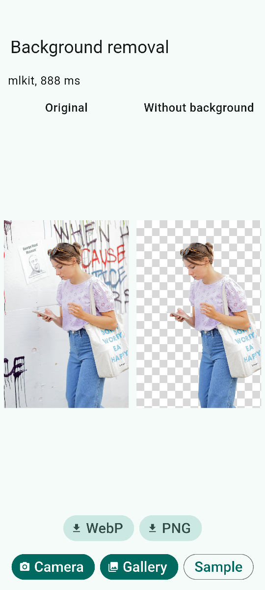

# bg_removal_example

An Android app that removes the background of a photo: take one with the
camera, pick one from the gallery, or try the bundled sample. The person and
what they carry stay; the cut-out shows next to the original, over a
checkerboard, and can be saved as WebP or PNG (a "save as" dialog, no storage
permission).



## What it uses

- `tekartik_bg_removal_flutter`: the photo from bytes, the removal in an
  isolate, `BgRgbaImageView`.
- `BgRemoverFallback([BgMlKitRemover(), BgOnnxRemover()])`: ML Kit Subject
  Segmentation (`tekartik_bg_removal_mlkit`) where Google Play services
  exist, else MODNet + u2netp on ONNX Runtime (`tekartik_bg_removal_onnx`,
  18 MB of models downloaded once). The engine is prepared at start; its
  status shows at the top.
- `image_picker` for the camera and the gallery (at most 1600 px: plenty for
  a cut-out, and under a second on a phone).
- `tekaly_file_download` to save the cut-out.

All of it is in `lib/src/home_page.dart`.

## The Android project

What the engines need, as the skill `tekartik-bg-removal-mlkit-android-setup`
says:

- `android/app/src/main/AndroidManifest.xml`: the `INTERNET` permission (the
  ONNX models are downloaded once) and the ML Kit meta-data
  (`com.google.mlkit.vision.DEPENDENCIES` = `subject_segment`, so that Play
  services installs the model with the app);
- `android/app/proguard-rules.pro`: keep ML Kit and ONNX Runtime from R8,
  or release builds fail;
- no launcher icon (the default one), to keep the repository small.

## Run

```sh
flutter run --release
# The README screenshot (a phone on adb): the sample at start, half size.
dart run tool/screenshot.dart [--device SERIAL]
```

## Credits

The sample photo is [Young woman with tote bag in Madison, Wisconsin
2020](https://commons.wikimedia.org/wiki/File:Young_woman_with_tote_bag_in_Madison,_Wisconsin_2020.jpg)
by John Benson, [CC BY 2.0](https://creativecommons.org/licenses/by/2.0),
resized.
