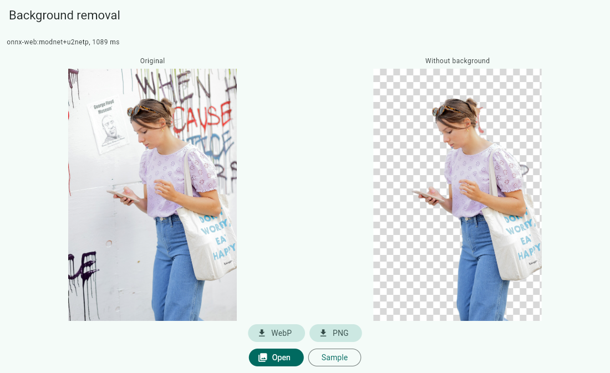

# bg_removal_example_web

The web version of the example: open a photo (or try the bundled sample),
its background is removed in the browser, the person and what they carry
stay, and the cut-out can be downloaded as WebP or PNG. Nothing leaves the
browser.



## What it uses

- `bg_removal_example_common`: the page, shared with the Android example
  `../bg_removal_example` (the two apps never depend on each other).
- `BgOnnxWebRemover()` (`lib/main.dart`, `tekartik_bg_removal_web`): MODNet +
  u2netp on onnxruntime-web (wasm). The engine loads onnxruntime-web from
  jsdelivr and fetches the 18 MB of models once (Hugging Face), checked by
  sha256 and kept in the browser's cache. ML Kit is Android only.

## Run

```sh
flutter run -d chrome --release
# The README screenshot (headless Chrome): the sample at start.
dart run tool/screenshot.dart
```

`flutter run` serves the page without cross-origin isolation: onnxruntime-web
then uses one thread. Deployed, serve it with
`Cross-Origin-Opener-Policy: same-origin` and
`Cross-Origin-Embedder-Policy: credentialless` (as `tool/screenshot.dart`
does) for wasm threads, and host the models with the app (see the skill
`tekartik-bg-removal-web-setup`).

The removal runs on the page's thread (no isolates on the web): about a
second on a desktop for a 1600x1200 photo, more on a phone.
